[English (英語版はこちら)](./index.html) | [ライフサイクル（リリース・導入・自動更新）](./lifecycle_ja.html) | [MCP仕様](./mcp_ja.html) | [AIプロンプト](./prompt_ja.html)

# はじめてのTWSNMP NEO
次世代コンテナネイティブ・Webベース ネットワーク管理システム

{: width="200"}

---

## 1. はじめに

**TWSNMP NEO** は、長年にわたり日本のネットワーク管理で親しまれてきた **TWSNMP** シリーズの最新進化版です。
コンテナ版 **TWSNMP FC** のポータビリティと、デスクトップ版 **TWSNMP FK** の高度な可視化・AI連携機能を完全に統合し、最新の Web 標準（Go 1.27+ / Svelte 5 / TypeScript）で再構築されました。

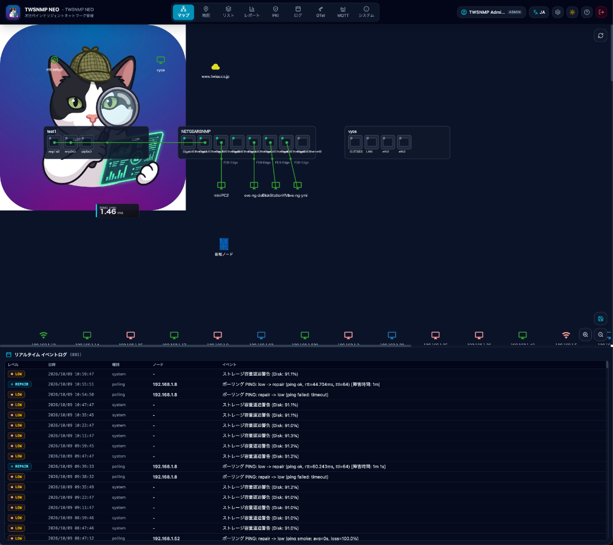

### 主な特徴
- **ブラウザだけで完結する高度な運用**: インストール不要でPCやタブレットのブラウザからアクセス可能。
- **p5.js & 3D WebGL マップ**: スイッチングハブの物理ポートやLED点灯状態、3Dハードウェアパネルをリアルに再現。
- **Apache Parquet 列指向ストレージ**: 数百万件の Syslog、TRAP、NetFlow、sFlow を高速圧縮保存し、瞬時に検索・集計。
- **マルチLLM & 内蔵 MCP サーバー**: 生成AI（Gemini, OpenAI, Claude, Ollama）と Model Context Protocol (MCP) を標準搭載し、AIによるログ原因調査やポーリング作成を支援。
- **ゼロ依存プライベート PKI**: ブラウザから即座に Root CA を立ち上げ、ACME/SCEP による証明書自動配布を実現。

---

## 2. インストールと起動

TWSNMP NEO は、Docker コンテナ、Homebrew、Windows サービス、単一実行バイナリとして多様な環境で動作します。


> 📖 **詳細ガイド**: 各プラットフォームごとの詳細なセットアップ手順や自動更新の仕組みについては **[ライフサイクルガイド（リリース・導入・自動更新）](./lifecycle_ja.html)** をご覧ください。

### Docker による起動（推奨）

最も簡単な起動方法は Docker です。データ保存用ディレクトリをマウントして起動します：

```bash
docker run -d \
  --name twsnmpneo \
  --restart always \
  -p 8080:8080 \
  -p 514:514/udp \
  -p 162:162/udp \
  -p 2055:2055/udp \
  -p 6343:6343/udp \
  -v $(pwd)/data:/data \
  ghcr.io/twsnmp/twsnmpneo:latest
```

起動後、ブラウザで `http://<ホストのIP>:8080` にアクセスします。

### Docker Compose による起動

`docker-compose.yml` を作成して管理することも可能です：

```yaml
services:
  twsnmpneo:
    image: ghcr.io/twsnmp/twsnmpneo:latest
    container_name: twsnmpneo
    restart: always
    ports:
      - "8080:8080"       # Web UI & REST / MCP API
      - "514:514/udp"     # Syslog UDP
      - "162:162/udp"     # SNMP TRAP UDP
      - "2055:2055/udp"   # NetFlow / IPFIX
      - "6343:6343/udp"   # sFlow
    volumes:
      - ./data:/data
```

```bash
docker compose up -d
```

### Homebrew (macOS / Linux)

macOS や Linuxbrew では Homebrew Tap より手軽に導入可能です：

```bash
brew install twsnmp/tap/twsnmpneo
twsnmpneo -datastore ./data -port 8080
```

### Windows (スタンドアロン & Windows サービス常駐)

[GitHub Releases](https://github.com/twsnmp/twsnmpneo/releases) より `twsnmpneo_windows_amd64.zip` をダウンロード・展開し、管理者権限のコマンドプロンプトや PowerShell から Windows サービスとして登録・常駐化できます：

```powershell
# サービス登録（OS起動時に自動起動）
.\twsnmpneo.exe service install -service-auto -datastore C:\twsnmpneo\data -port 8080

# サービス開始
.\twsnmpneo.exe service start
```

### Linux (curl インストーラー & systemd サービス常駐)

```bash
# curl ワンライナーインストール
curl -sS https://raw.githubusercontent.com/twsnmp/twsnmpneo/main/install/install.sh | sh

# 特権ポート (514/162) & Rawソケット (Ping) 許可
sudo setcap 'cap_net_bind_service,cap_net_raw+ep' /usr/local/bin/twsnmpneo

# 一般プロセスとして直接起動
twsnmpneo -datastore ./data -port 8080

# または Linux systemd サービスとして登録（OS起動時に自動起動）
sudo twsnmpneo service install -auto -datastore /var/lib/twsnmpneo -port 8080
sudo twsnmpneo service start
```

### スマート自動更新 (Self-Updater)

動作環境を自動検出し、CLI や Web UI から安全に自己更新を実行できます：

```bash
# 更新チェック
twsnmpneo update -check

# 最新バージョンへ即時更新 & プロセス自動再起動
twsnmpneo update -y
```

---

## 3. 画面構成と基本操作

TWSNMP NEO は直感的なシングルページアプリケーション（SPA）です。


- **上部ヘッダーバー**:
  - **マップ / レポート / PKI / ログ / 設定**: 各機能画面へのワンクリック遷移。
  - **ライト / ダークモード切替**: 視認性に優れたテーマ切り替え。
  - **全体障害ステータス**: 重大・警告・注意の発生件数を常時表示。
- **メインキャンバス**: トポロジーマップのインタラクティブ操作（ズーム、パン、ドラッグ＆ドロップ）。
- **コンテキストメニュー**: ノードやネットワーク（SW-HUB）、ライン、描画アイテムを右クリックして直感的に操作できます。「情報」「編集」「削除」の操作体系が統一され、ノードではMACアドレス登録時のみ「Wake On Lan」が表示されるなど、状態に応じたスマートなメニュー構成になっています。

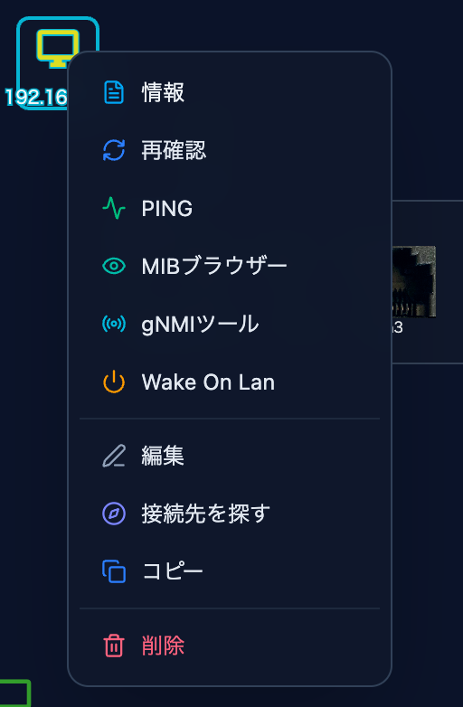

---

## 4. マップ画面

### ノードとネットワーク（SW-HUB ポートパネル）

- **ノード**: サーバ、ルーター、PC などの機器を表します。状態カラー（緑:正常、黄:注意、赤:障害、灰:停止）で発光・点滅します。
- **ネットワーク（SW-HUB コンテナ）**: スイッチングハブの物理ポートを再現します。ポートのリンク状態（UP/DOWN）や接続先ラインがビジュアルに表示されます。

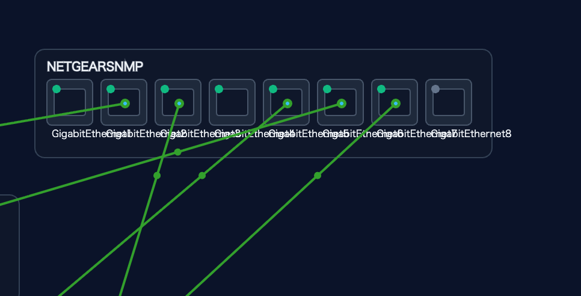

ネットワーク（SW-HUB）を右クリックすると専用メニューが開き、情報確認、PING、MIBブラウザー、接続先トポロジー探索、ネットワーク自体の編集、および接続ポートの「ライン編集」を直接実行できます：

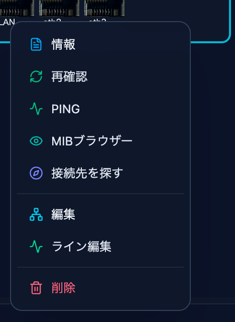

登録されているスイッチングハブやネットワークは専用のインベントリ一覧でも管理できます：

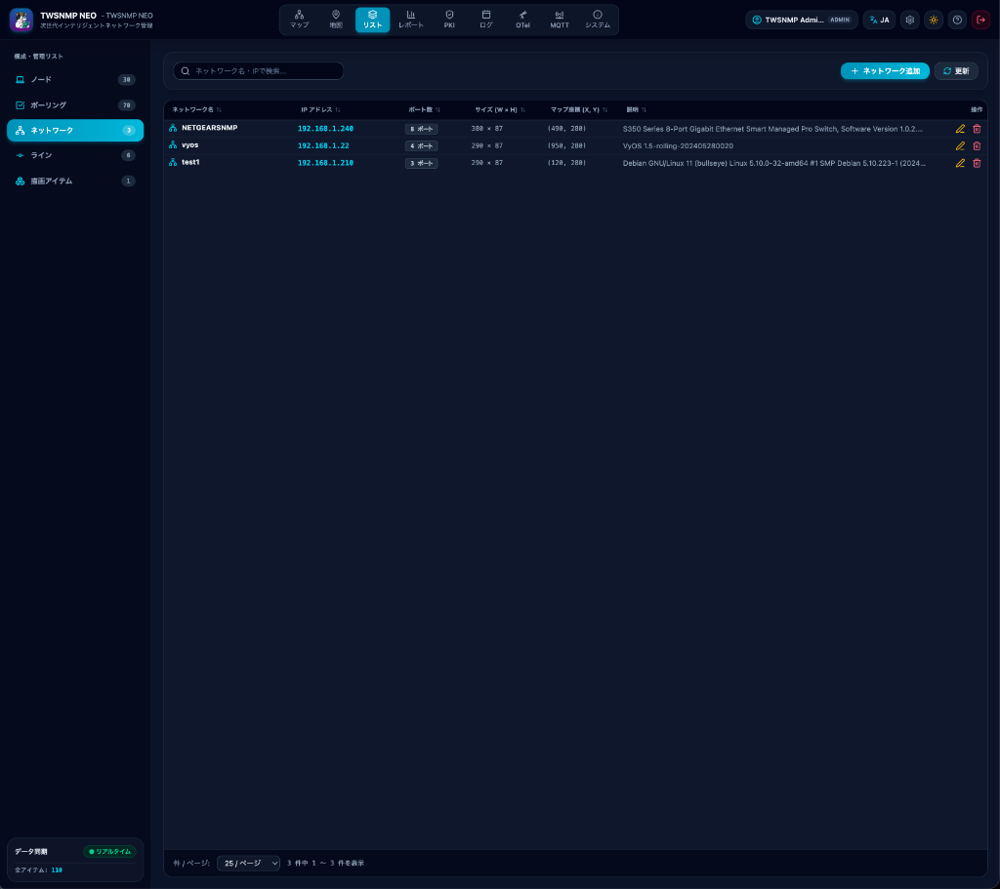

### ライン接続とトラフィックフロー

ノード間や SW-HUB ポート間の接続線をドラッグまたは Shift+クリックで結びます。ポーリングと連動して、送受信トラフィック量に応じた**線の太さ**や**パケットフローアニメーション**が動的に変化します。

ライン一覧画面では、接続元・接続先、線幅、検出理由（LLDP/FDB-Edge等）、接続健全性をテーブル形式で確認・編集できます：

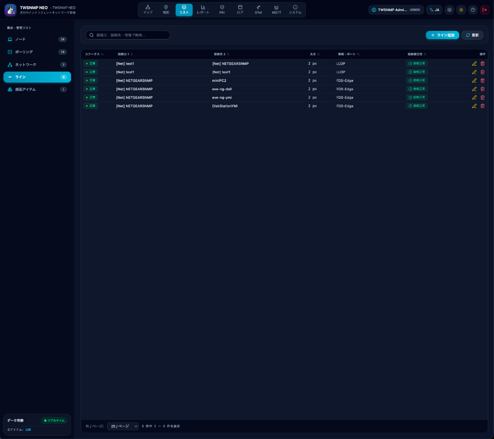

### 描画アイテム（全11種類）

マップ上には監視対象機器だけでなく、自由なレイアウト要素（描画アイテム）を配置できます：

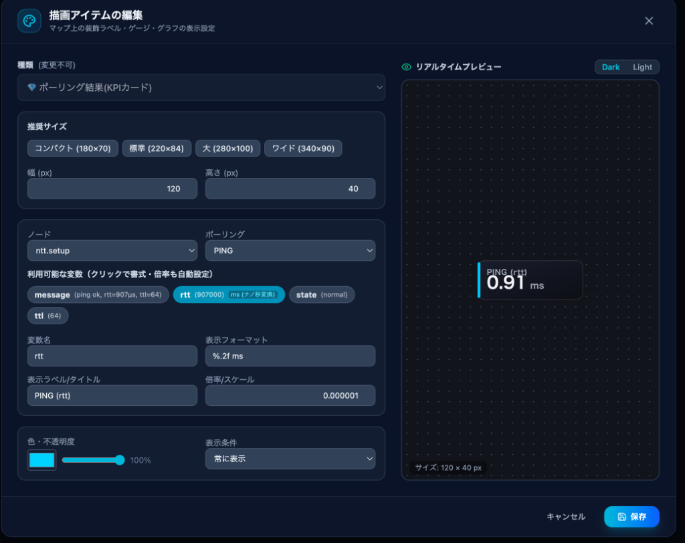

1. **矩形 / 楕円**: エリアのグループ化やゾーン分け
2. **テキスト / ラベル**: ネットワーク名や説明文
3. **静的画像**: フロアマップやラック図
4. **クラシックゲージ**: アナログ風の針メーター
5. **円形ラジアルゲージ**: CPU/メモリ使用率等のドーナツ表示
6. **横棒グラフ**: ストレージ残量や帯域利用率
7. **折れ線スパークライン**: トラフィックやレスポンス推移
8. **リアルタイム KPI カード**: ポーリング値（温度、Ping応答時間、パケット数）の巨大数値表示

配置したすべての描画アイテムは、描画アイテム一覧テーブルでも一元管理・編集できます：

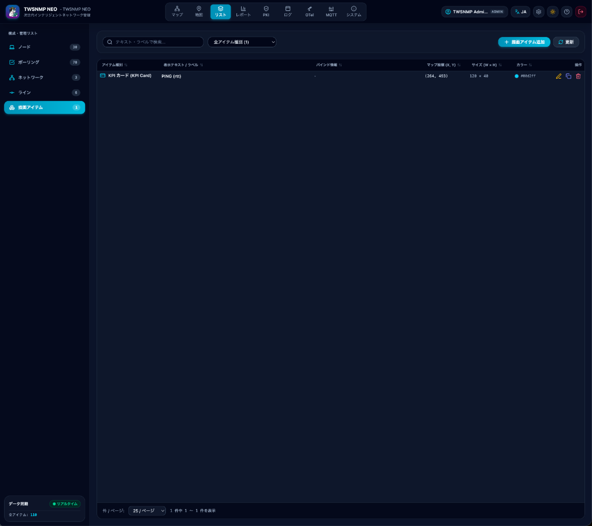

### 3D 仮想ハードウェアパネル（vpanel）

スイッチやルーターのノードを右クリックして「仮想パネル」を開くと、WebGL による 3D 筐体が表示されます。

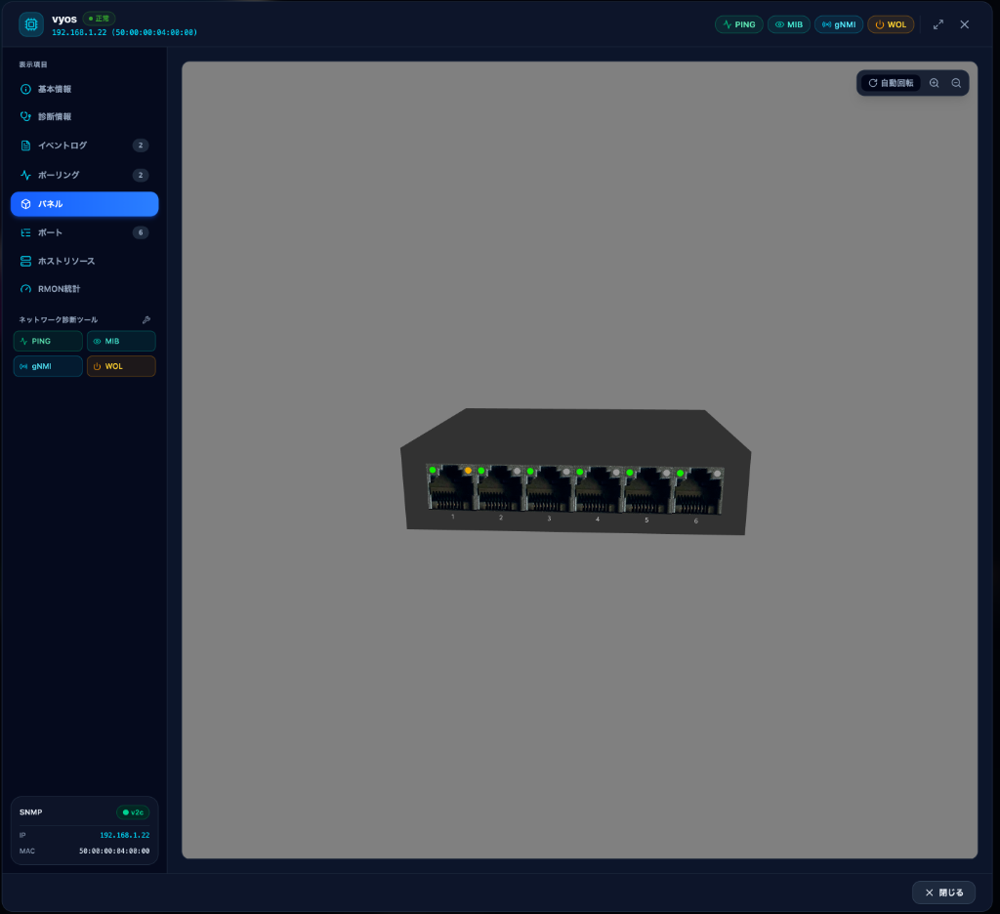

- マウスドラッグで 3D 空間を自在に回転（Orbit Controls）。
- 各ポートの RJ45 コネクタ、Link UP/DOWN 緑 LED、1Gbps+ 通信橙 LED、POWER 青 LED がリアルタイムに点灯します。

### マップキャンバスメニューと自動レイアウト

マップの余白（背景）を右クリックすると、キャンバス操作メニューが開きます：
- **ノード・ネットワーク・描画アイテム・ラインの即時追加**: マップ上の任意の位置に各種要素を追加。
- **全て確認 / 自動発見**: 一括状態更新や自動探索の起動。
- **自動レイアウト**: 複雑に配置されたノード群を、ワンクリックでアルゴリズムに基づいて自動整列（階層型、クラスター型、分類型、グリッド整列）。

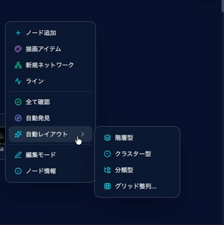

### マップ設定と背景画像

マップ設定からマップの全体外観を細かくカスタマイズできます：
- **マップ名 & キャンバスサイズ**: 自動リサイズまたは固定キャンバス解像度の設定。
- **ノードアイコンサイズ**: 1（最小）〜 5（最大）のスライダー調整。
- **背景画像設定**: オフィスレイアウト図や地図画像をアップロードし、座標オフセット（X, Y）やサイズを指定して下敷きに設定。
- **マップデータインポート**: TWSNMP FC / FK / NEO でエクスポートしたマップ定義の復元・取り込み。

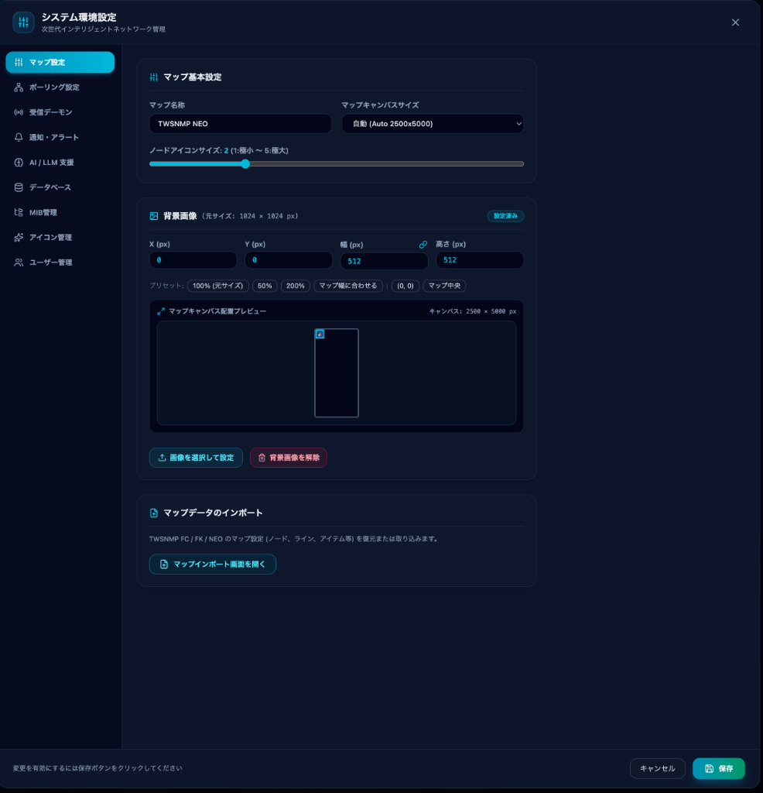

---

## 5. 自動発見とトポロジー探索

### IPレンジ自動発見

指定したサブネット（例: `192.168.1.1/24`）に対して、高速に Ping/SNMP/ARP スキャンを実行し、稼働中のデバイスを自動的にマップ上に登録します。

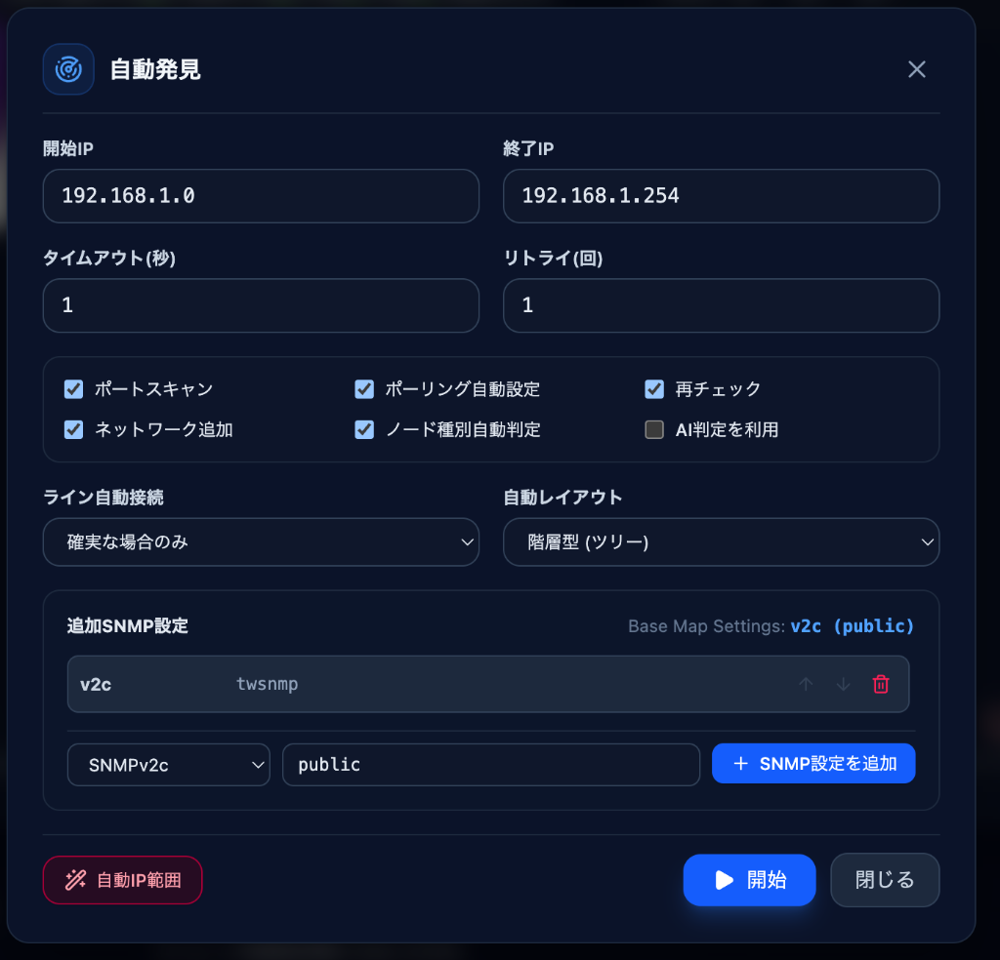

実行中はプログレスバーとともに、検出されたポート・サービス種別（SNMP、Web、SSH、Mail、File、RDP、LDAP）の内訳がリアルタイムに表示されます：

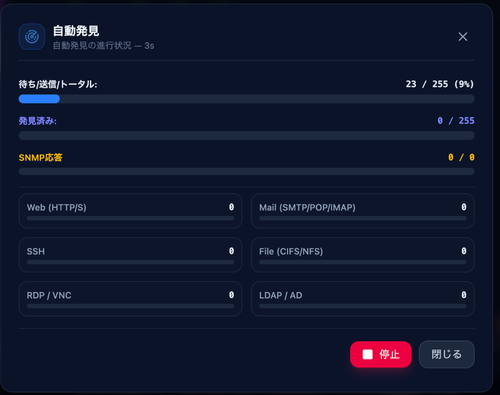

### 接続先トポロジー探索（Find Neighbor）

スイッチの ARP テーブル、FDB (MACアドレス学習テーブル)、LLDP / CDP 情報を自動解析し、どのノードが SW-HUB のどのポートに接続されているかを自動判定して結線を生成します。
ワイドなダイアログにより折り返しを解消し、判定理由（LLDP、FDB-Edge、ARP等）と判定確信度（%）がひと目で把握できます：

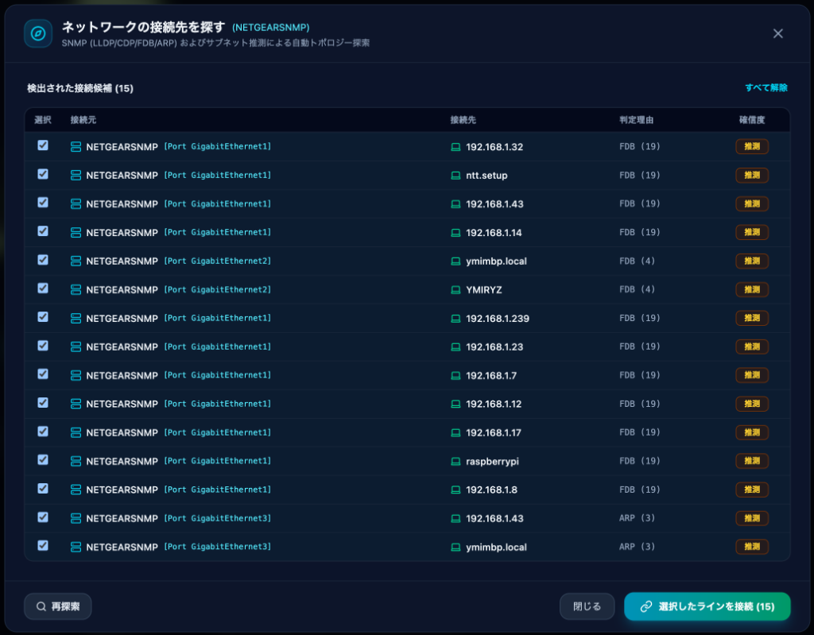

---

## 6. ノード & ポーリング管理

### ノードリストとノード詳細

監視対象ノードの一覧、IP/MACアドレス、ベンダー情報、稼働状態をインベントリリストでリアルタイムに検索・管理できます：

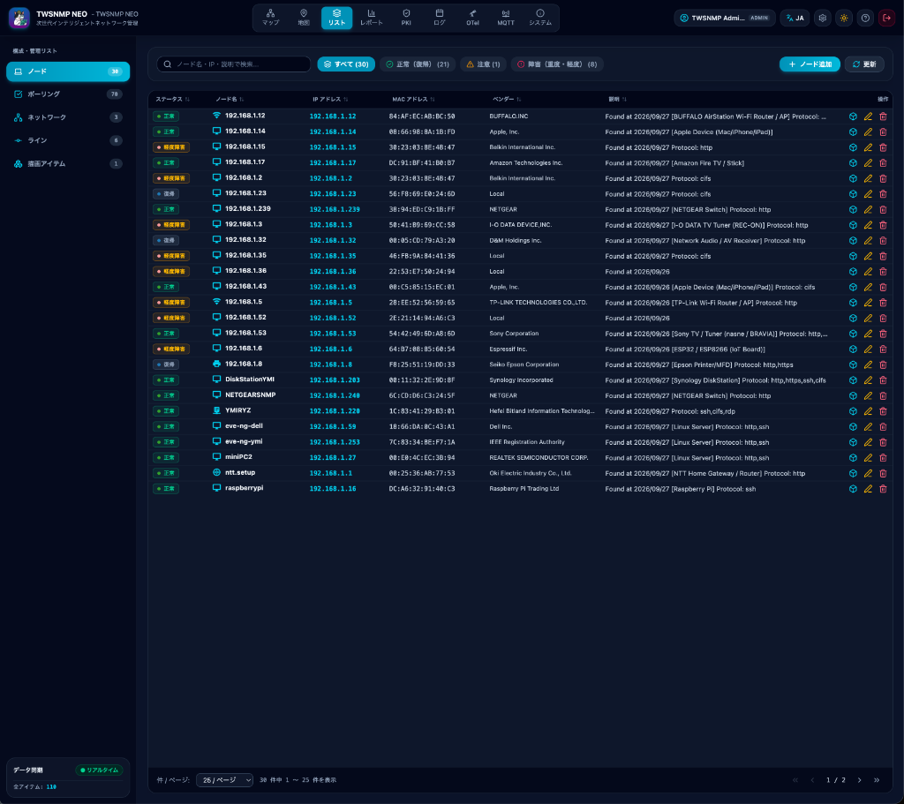

ノードを右クリックして「情報」を選択すると、ホストリソースやシステム稼働状況に加え、そのノードに**設定されているポーリング一覧**が直接確認できます。一覧から各ポーリングの履歴チャートや編集へダイレクトにアクセスでき、上部ボタンからノードプロパティの即時編集も可能です。

### ノードプロパティ編集（2カラム & 共通認証対応）

ノードの編集画面は、見通しの良いワイドな2カラムレイアウトに刷新されています：
- **左カラム（基本情報）**: ノード名、IPアドレス、MACアドレス、アイコン種別（MDI/カスタム画像）、自動検出ボタン。
- **右カラム（通信設定 & 認証情報）**: プロトコル選択に応じた動的入力制御、Web監視用の複数URL登録、およびシステム設定で登録した「共通認証情報」からのワンクリック自動適用。

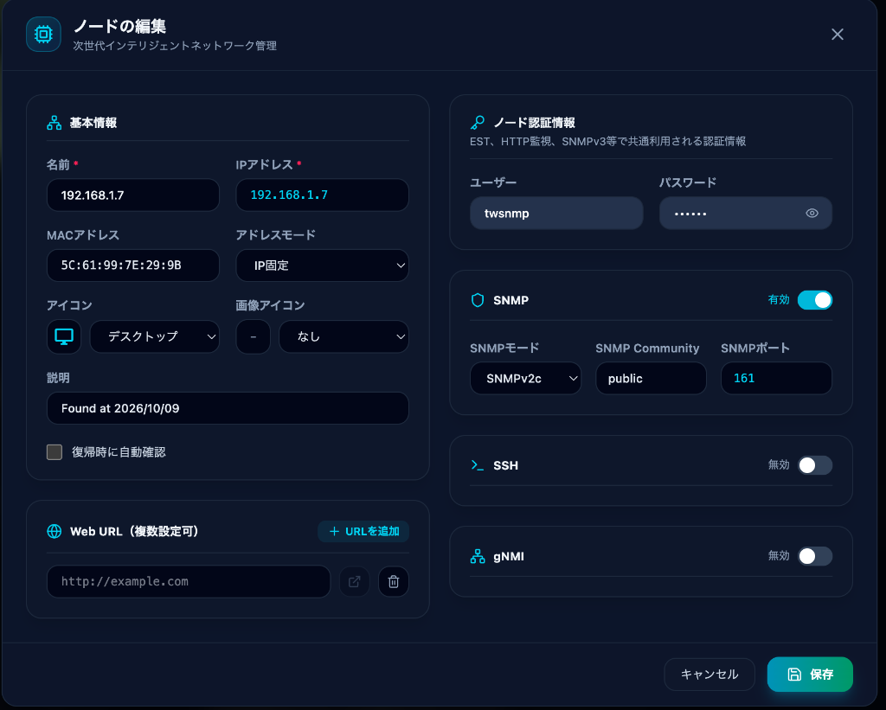

### 多彩なポーリングプロトコル

TWSNMP NEO は以下のプロトコル・方式による死活・性能監視に対応しています：
- **PING (ICMP / UDP / Smokeping / MTR)**
- **SNMP (v1 / v2c / v3 - Get / Walk / 表形式)**
- **HTTP / HTTPS (ステータスコード / レスポンスタイム / キーワード照合 / SSL証明書)**
- **TCP / TLS ポート開放確認**
- **DNS / NTP クエリ**
- **gNMI (gRPC ネットワーク管理)**
- **STUN (グローバルIP変動・NATタイプ監視)**
- **MQTT (トピック購読 / メトリックポーリング)**

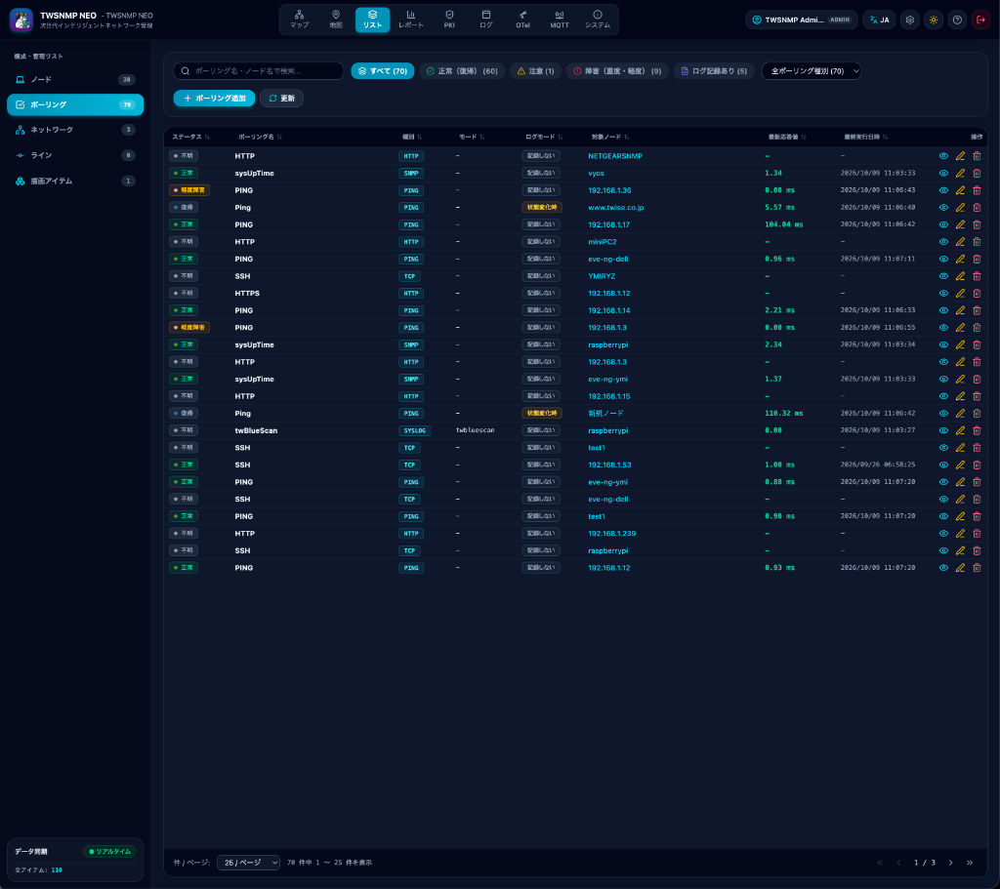

システム設定内のポーリング設定画面から、標準ポーリング間隔、タイムアウト、リトライ回数、デフォルトSNMPモード、コミュニティ名などの全体デフォルト値を設定できます：

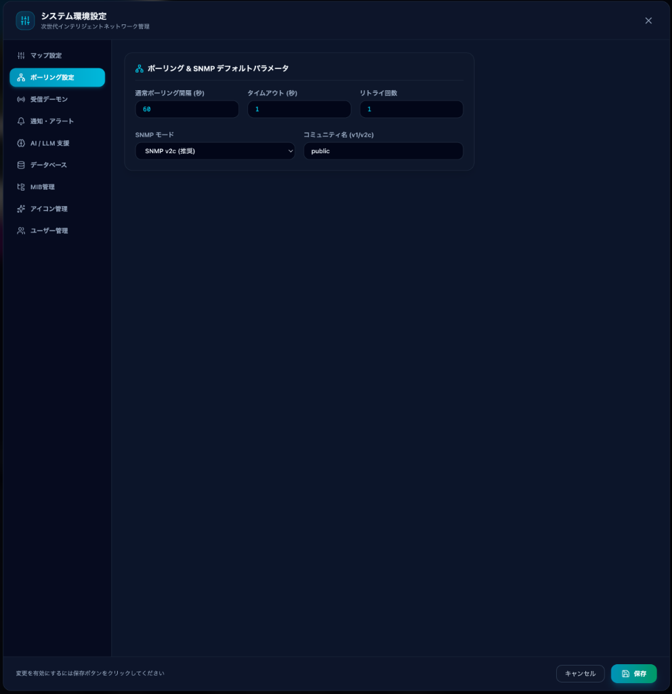

### AIポーリング設定アシスタント

自然言語（日本語）で「WebサーバーのCPU使用率が80%を超えたら警告にするポーリングを作って」と入力するだけで、LLM が適切な SNMP OID や閾値判定スクリプトを自動生成する機能です。（※現在は実験的機能として準備中）

---

## 7. 診断・運用ツール

### Ping / Smokeping / MTR

- **リアルタイム Ping**: 連続送信、応答時間推移グラフ、音声フィードバック。
- **Smokeping**: パケットロスの分布とレイテンシの揺らぎを可視化。
- **MTR**: 経路上の各ルーターのホップごとの応答状況と AI 分析。

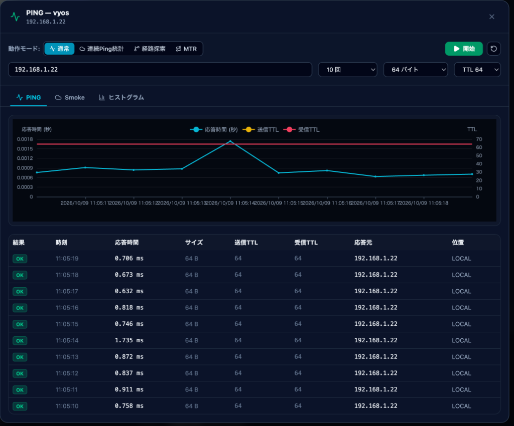

### MIBブラウザ & MIBツリー

標準 MIB (RFC1213, Host Resources, IF-MIB 等) およびベンダー拡張 MIB のツリーを探索できます。
SNMP Get / GetNext / Walk / Table 取得をワンクリックで実行し、表形式データのソートや CSV エクスポートが可能です。

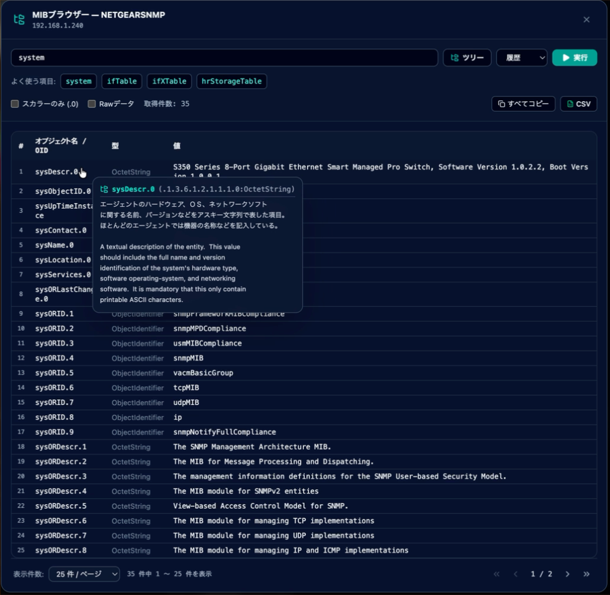

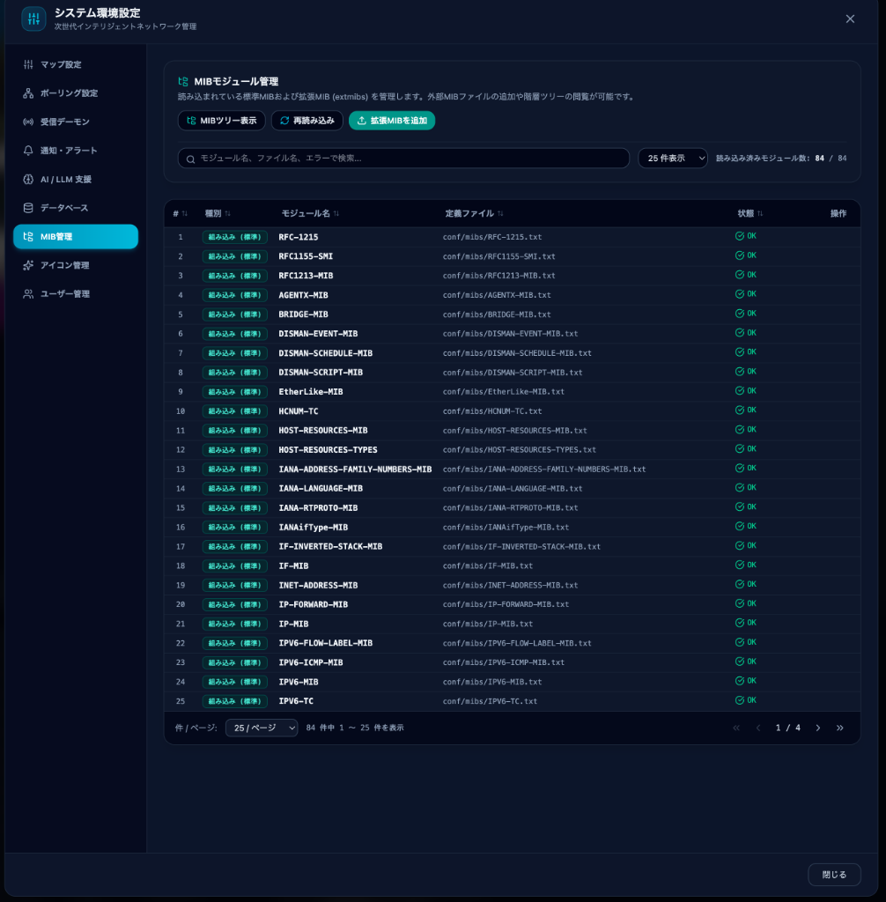

### gNMI ツール

次世代ネットワーク機器（gRPC Network Management Interface）の Telemetry 取得や Config 参照を行えます。

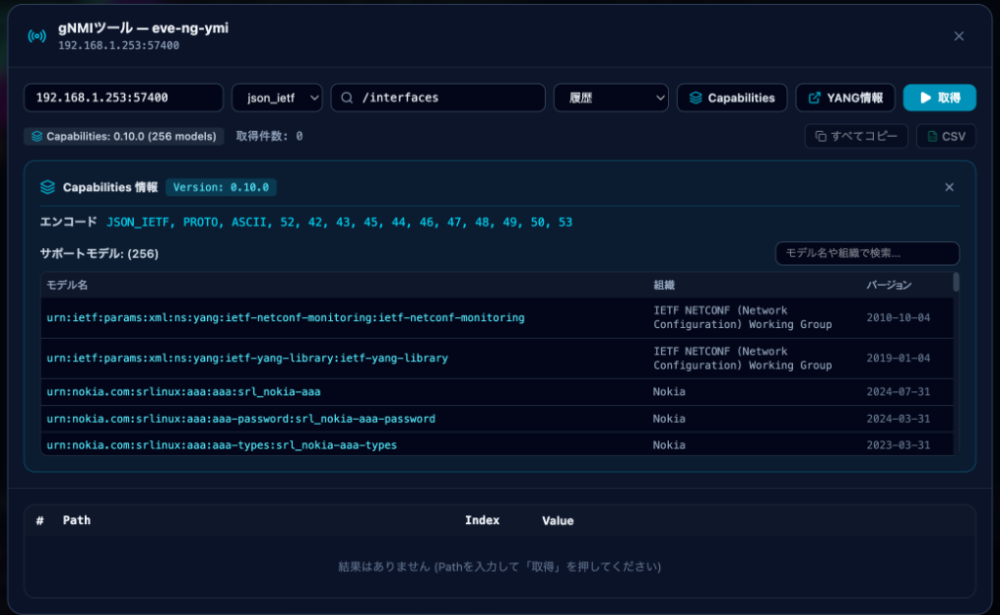

### Wake-on-LAN (WOL)

マップ上のノード右クリックメニュー、またはノード詳細画面の上部にある「WOL」ボタンから実行できます。
対象ノードの MAC アドレスに対して Magic Packet を送信し、リモートから端末の電源投入（起動）を行います。

---

## 8. 分析 & レポートスイート

10系統の強力な分析エンジンを搭載しています：

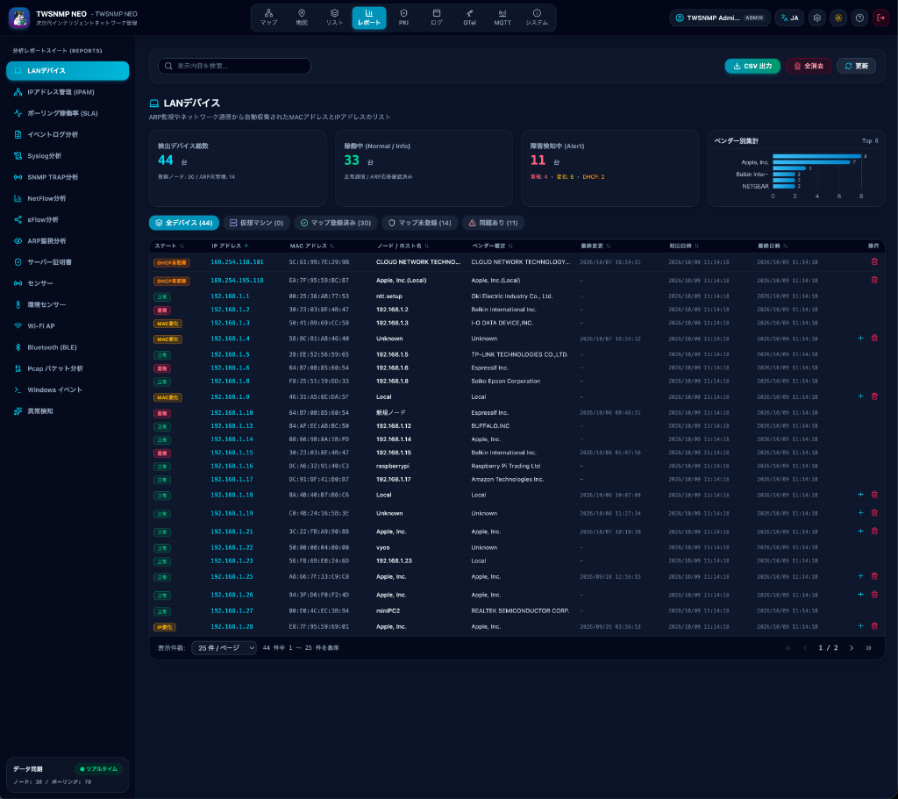

### デバイス分析（LAN / Wi-Fi / Bluetooth / FDB）
MAC OUI ベンダー分析、電波強度、新規接続機器の検出。

### IPAM（IPアドレス管理ヒートマップ）
サブネットごとの空き状況・使用率ヒートマップ、IP競合の検出。

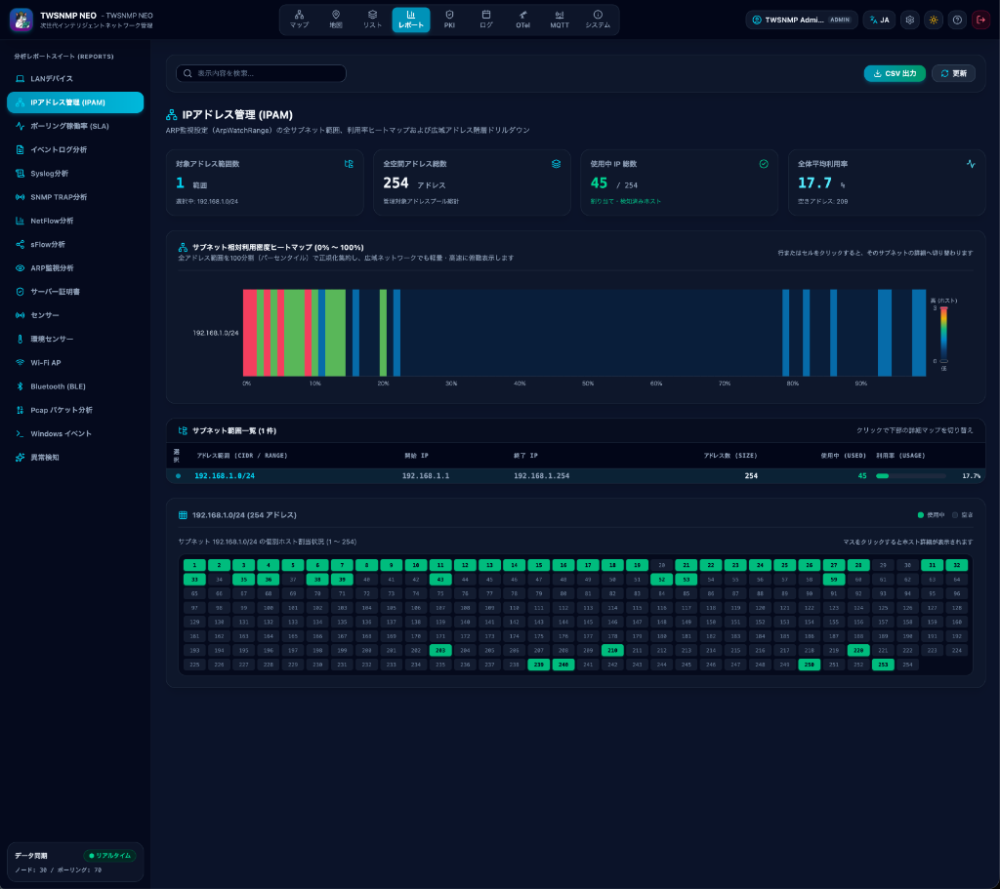

### フロー & トラフィック（NetFlow / sFlow / Fumble）
Topトーカー、Topプロトコル、スキャンや未応答SYN（Fumble）等の異常通信分析。

### ホスト分析（Windowsイベント / プロセス等）
Windowsイベントログオン監査、特権昇格、プロセス・サービス稼働分析。

### IoT & センサー（環境センサー / 電力）
温度・湿度・気圧・電力（Wh）の推移グラフと閾値監視。

### MQTT レポート
IoT/スマートデバイス向け MQTT のトピック別メッセージ頻度・サイズ統計、クライアント接続状況の集計および AI による傾向分析。

### OpenTelemetry (OTel) レポート
分散トレーシングや OTel メトリクスのサービス別集計、レイテンシ傾向、および AI によるボトルネック分析。

### セキュリティ & 証明書監視
TLS/SSL 証明書の有効期限残日数追跡、失効（CRL/OCSP）状態チェック。

### AI 異常検知スコア
各ノード・ポーリングの統計的異常スコアランキング。

### 各種レポートでのワンクリック「AI診断」
各レポート画面（Syslog、TRAP、NetFlow、IP、ARP、Sensor、MQTT、OTel 等）のツールバーにある「AI診断」ボタンをクリックすると、現在の集計・統計データを AI が即座に読み込み、ボトルネックや異常兆候の分析結果、推奨される対処手順を Markdown 形式で分かりやすく提示します。


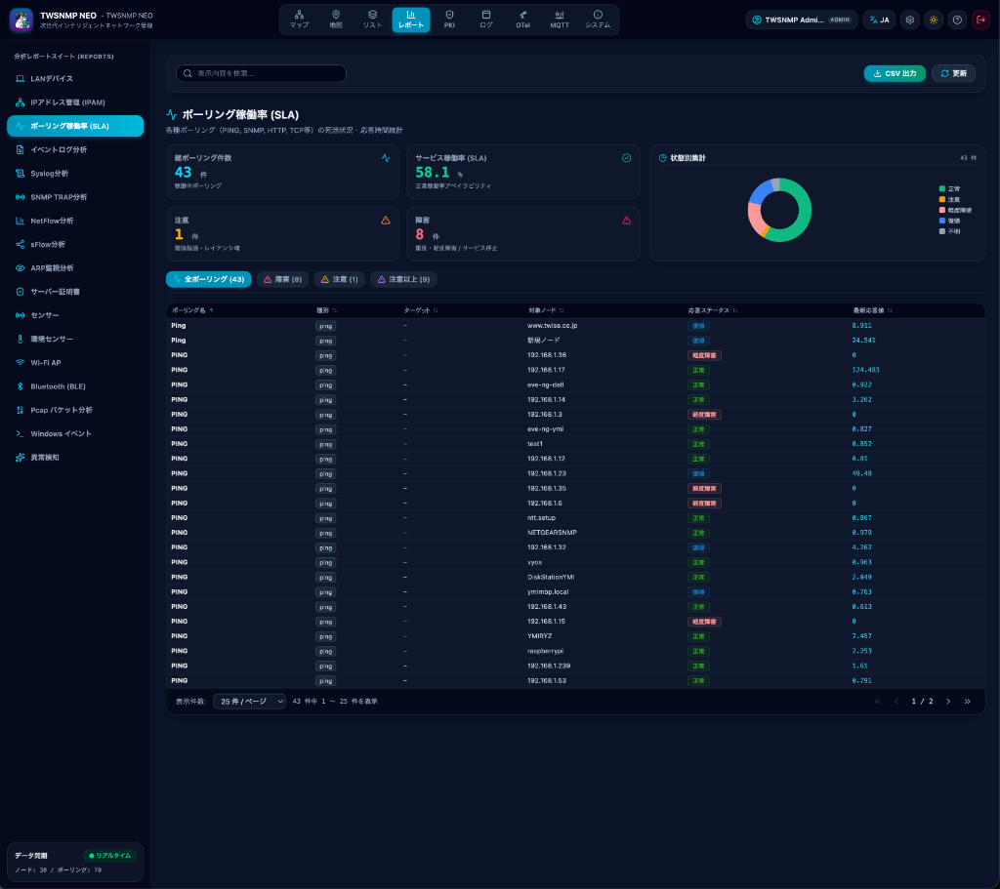

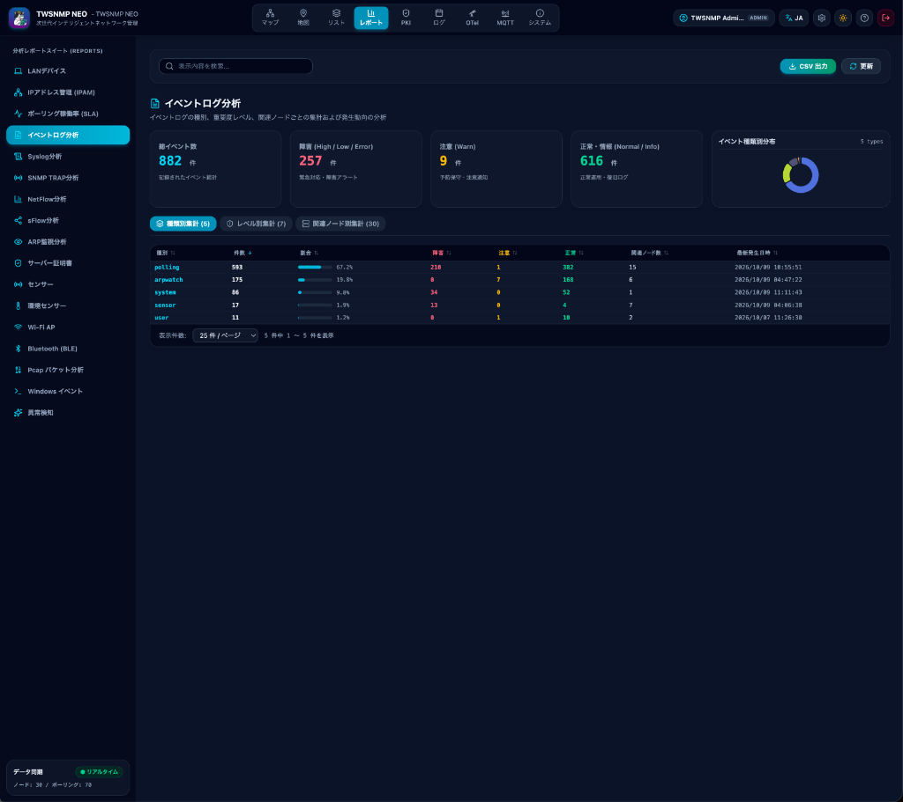

---

## 9. 高速ログ管理 (Apache Parquet)

TWSNMP NEO は、ログストレージに **Apache Parquet** 列指向圧縮フォーマットを採用しています。
従来の数倍の圧縮率と、1万件を瞬時に取得する圧倒的な検索速度を実現しています。

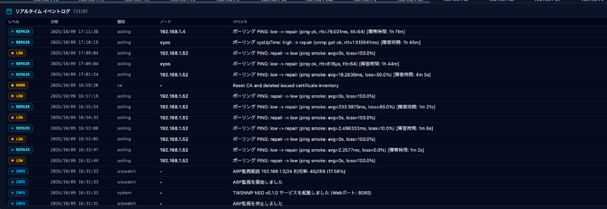


### 対応ログ一覧
- **イベントログ**: システムアラート、ポーリング状態変化、AI原因調査ボタン
- **Syslog**: UDP/TCP/TLS 受信、ファシリティ・プライオリティ別集計、正規化分析、FFT周期分析
- **SNMP TRAP**: v1/v2c/v3 受信、OID自動名前解決、3D送信元分析
- **NetFlow / IPFIX & sFlow**: フローサンプリング、カウンターサンプリング
- **ARP Watch**: IPとMACアドレスのペア変更履歴・不正接続検知
- **OpenTelemetry**: 分散トレース & OTel ログ
- **MQTT ログ**: IoT トピック受信履歴

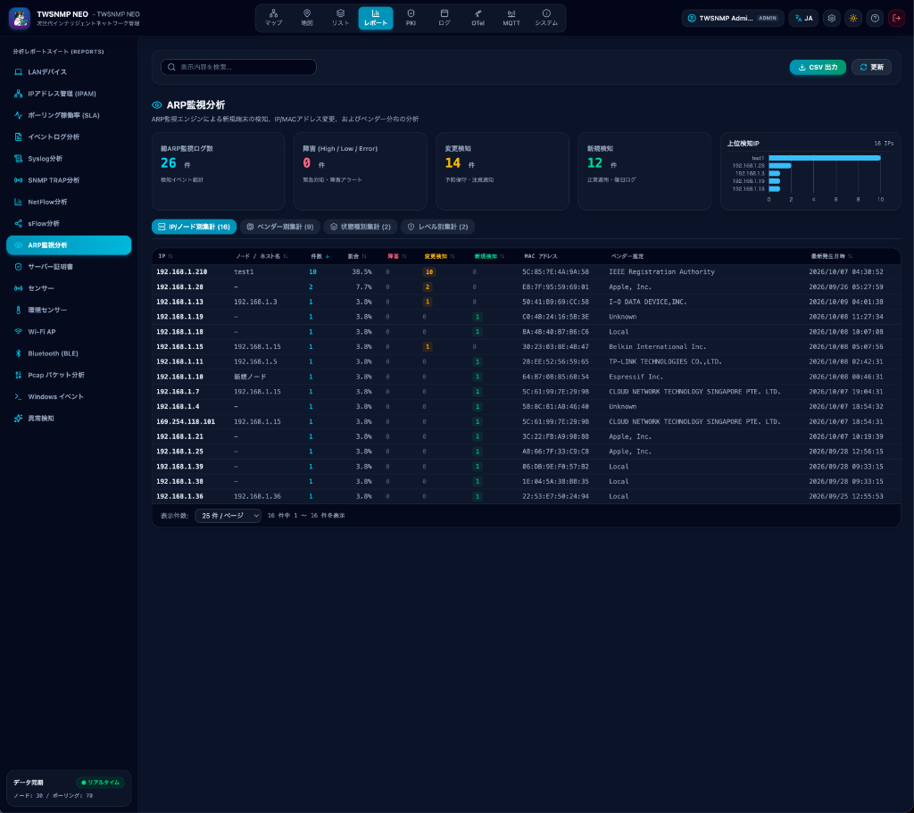

### レシーバー & デーモン設定
各ログ・パケット受信デーモン（Syslog UDP/TCP:514、SNMP TRAP UDP:162、NetFlow UDP:2055、sFlow UDP:6343、ARP Watch 監視CIDR範囲、OpenTelemetry OTLP gRPC/HTTP:4318、MQTT ブローカー）の有効化・待受ポートは、システム設定内の「レシーバー & デーモン設定」から個別に制御できます：

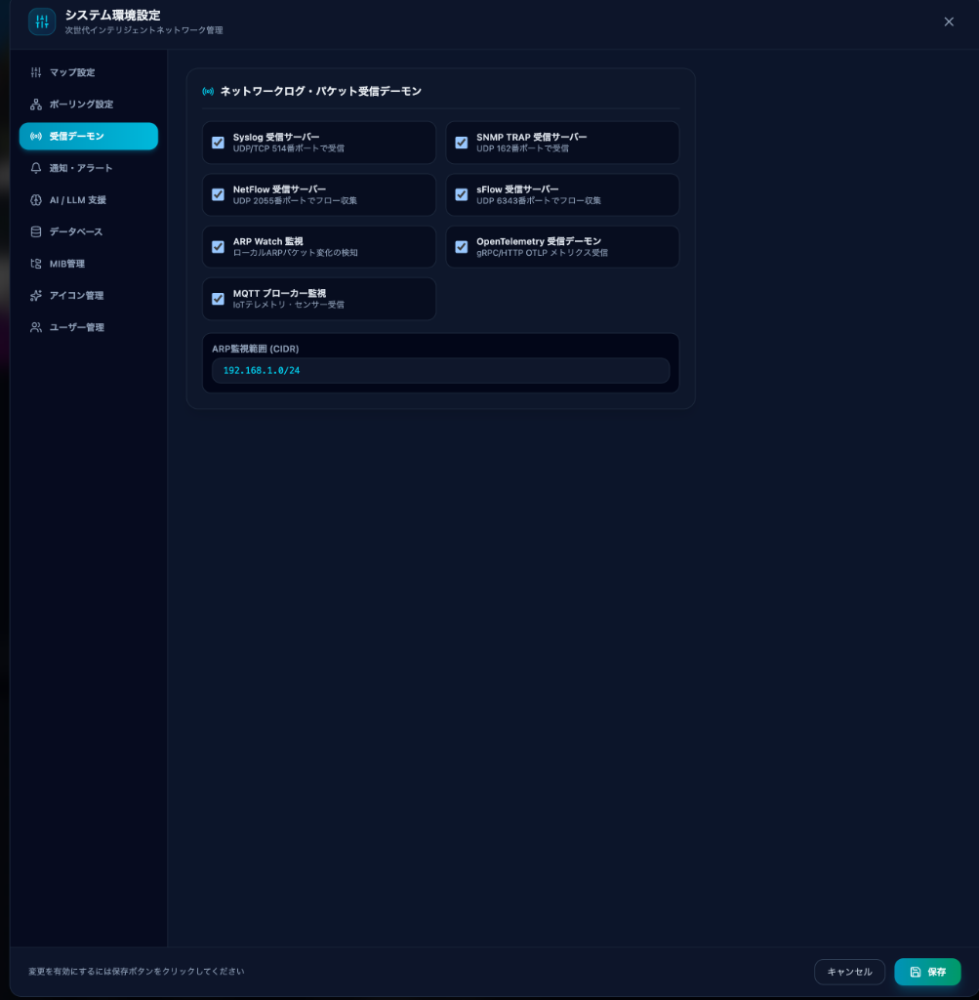

### AI原因調査
重大アラートが発生した際、ワンクリックで関連する前後ログを LLM が瞬時に要約・分析し、推定原因と推奨対処手順を Markdown 形式で分かりやすく提示します。

---

## 10. 内蔵 PKI (認証局) & TLS 管理

TWSNMP NEO は、外部の証明書管理ツールなしで動作する完全なプライベート PKI 機能を内蔵しています。Webサーバー版（TWSNMP FC）互換の堅牢なアーキテクチャを採用し、左側サイドバーによる直感的な操作が可能です。

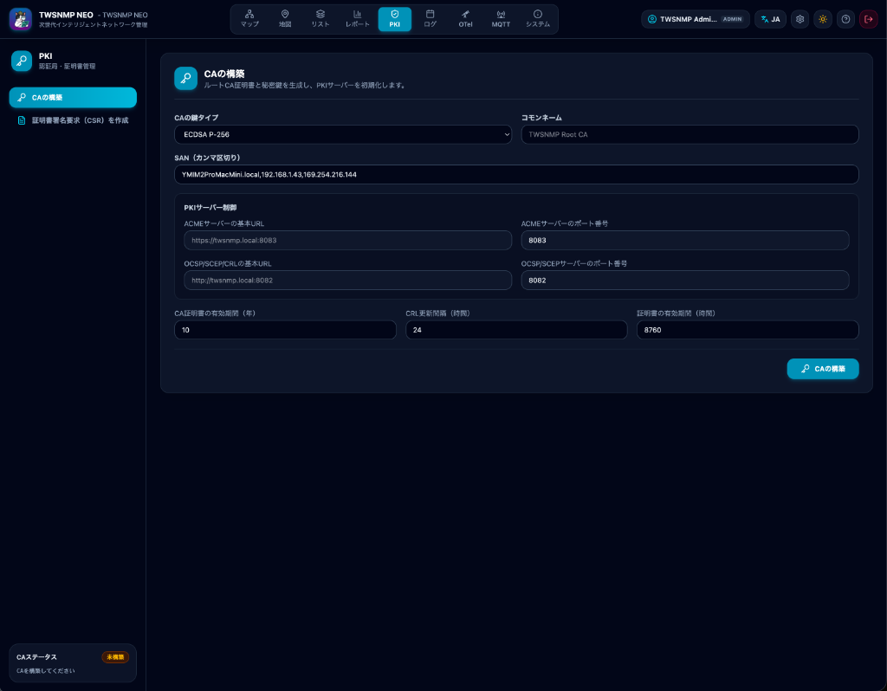

### Root CA 構築 & 証明書管理
画面から安全に秘密鍵と Root CA 証明書を生成し初期化（RSA / ECDSA 各種鍵長に対応）。発行済み証明書の一覧表示、失効証明書数の把握、横断キーワード検索、カラムソート、ページネーション、CSVエクスポート、PEM証明書の個別ダウンロードおよび失効操作に対応しています。

### ブラウザ内 CSR 作成
秘密鍵と CSR を同時に生成し、ZIP形式でまとめて即時ダウンロード。また、アップロードした CSR ファイルに対して CA による署名を行い、PEM 形式の証明書を発行・ダウンロードできます。

### CRL / OCSP / SCEP / ACME サーバー運用
- **プレーン HTTP サーバー (ポート 8082)**: Root CA 証明書 (`/ca.pem`)、SCEP CA 証明書 (`/scepca.pem`)、CRL (`/crl`)、OCSP (`/ocsp`)、SCEP (`/scep`) を配信（メインサーバーの TLS 化時にもブートストラップ問題や循環依存を回避）。
- **ACME サーバー (ポート 8083)**: RFC 8555 準拠の自動証明書管理プロトコル（Let's Encrypt 互換）。
- 稼働状態のリアルタイム確認（稼働状態に応じた背景色表示）およびポート・有効期間・更新間隔の即時設定変更。

### ACME 自動更新クライアント & サーバー証明書
TWSNMP NEO 自体の Web UI を HTTPS (TLS) で運用する際、Let's Encrypt などのパブリック ACME サーバーや内蔵 ACME サーバーから証明書を自動取得・自動更新する ACME クライアント機能（lego 統合）を搭載。既存の PEM 証明書・秘密鍵ファイルの指定や、TWSNMP FC からの証明書インポートにも対応しています。

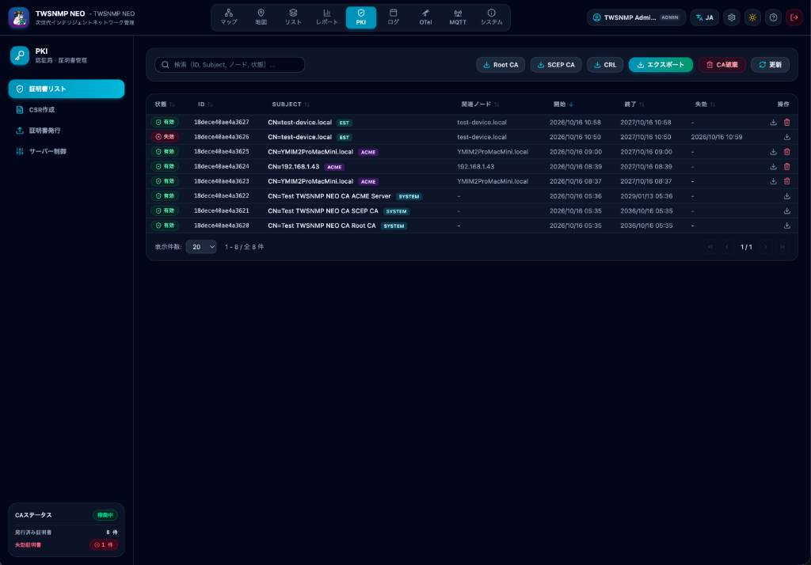

---

## 11. AI & MCP 統合

### LLM 設定（ローカル LLM / 各種クラウド AI）

設定メニューからお好みの AI プロバイダー（ローカル LLM `tensai`、Gemini、OpenAI、Claude、Ollama 等）を柔軟に選択できます。

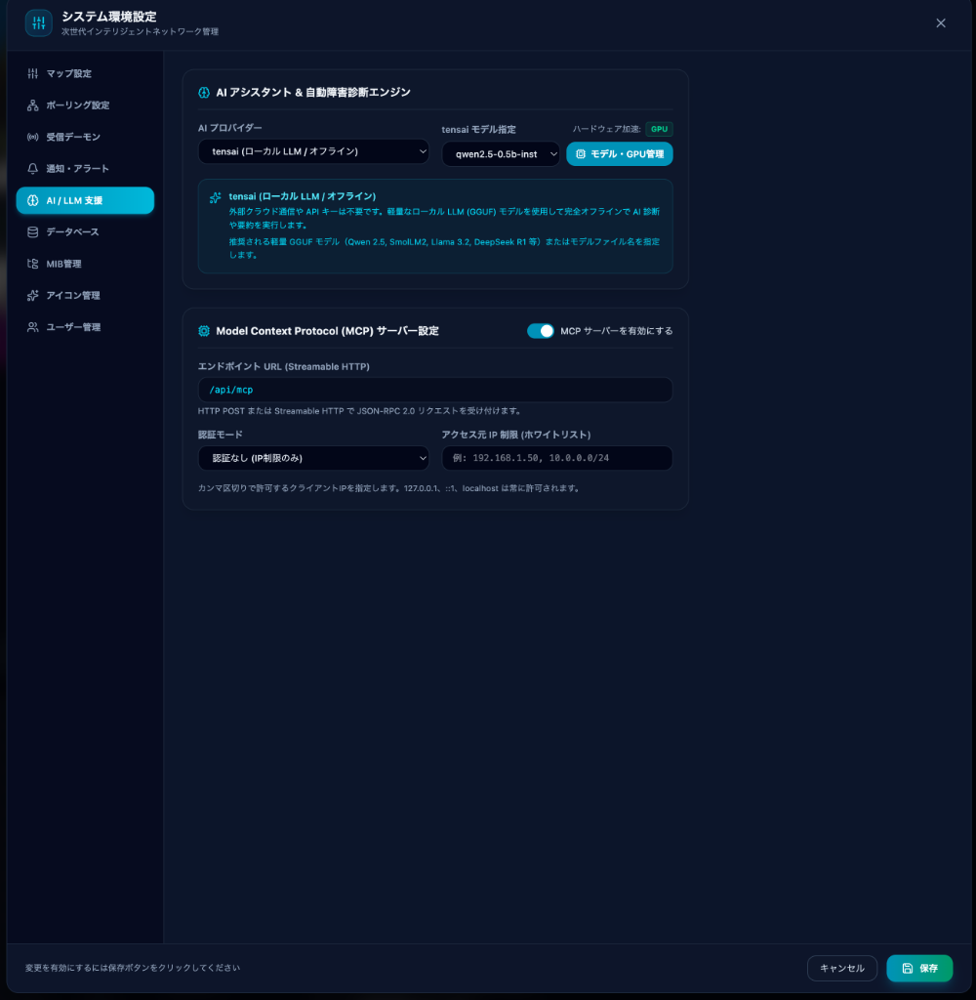

#### ローカル LLM & WebGPU アクセラレーション
外部クラウドへの通信や API キー不要で、完全オフラインで動作する組み込み推論エンジン（`tensai` v0.0.35+）を搭載。Hugging Face からのワンクリックモデルダウンロードや WebGPU による高速推論に対応しています。診断結果はリッチな Markdown 表示、言語切替、スムーズなローディングアニメーションを備えています。

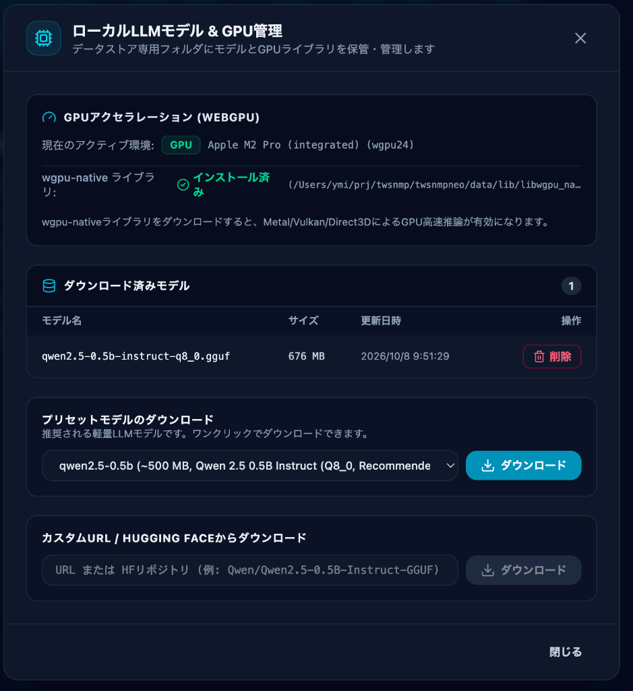

### 内蔵 MCP サーバー
Streamable HTTP (`/api/mcp`) による Model Context Protocol サーバーを標準搭載。Cursor、Claude Desktop、Antigravity などの AI エージェントから TWSNMP NEO に直接接続し、ネットワーク情報の問い合わせや障害診断を自律的に実行させる連携が可能です。

詳細な構想やツール一覧は、**[MCP サーバー仕様・連携ガイド](mcp_ja.html)** および **[AI プロンプトガイド](prompt_ja.html)** をご覧ください。

---

## 12. 設定 & システム管理

### システム状態 & リソースモニター（2タブ構成）

システム管理画面は、目的に応じて整理された 2 つのタブで構成されています：

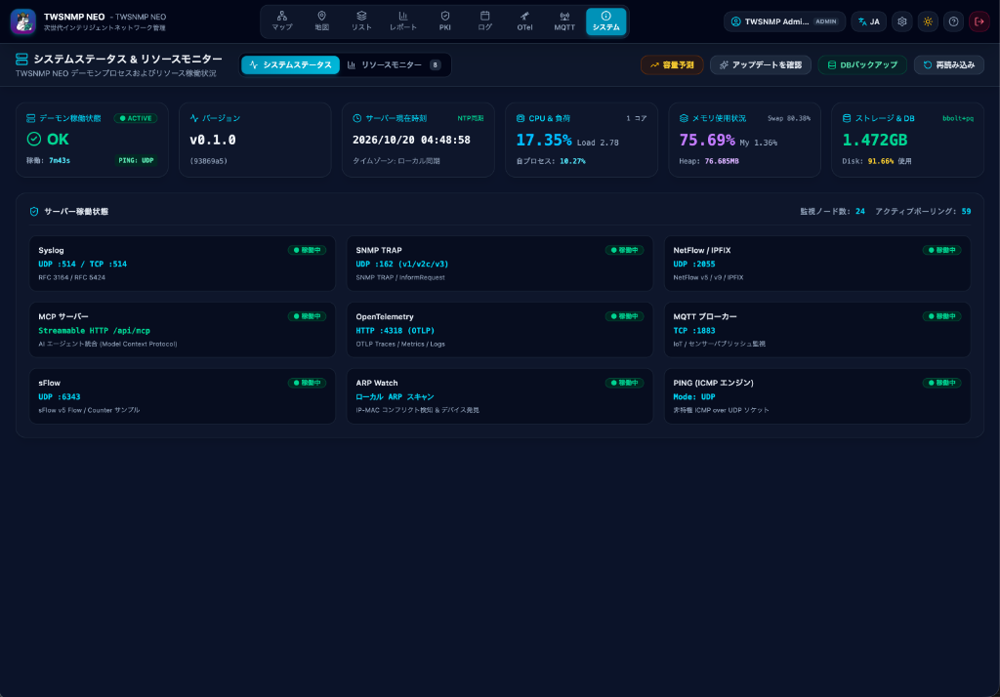

- **「システムステータス」タブ**:
  - **デーモン稼働状態**: Syslog、TRAP、NetFlow、sFlow、ARP Watch、OpenTelemetry、MQTT、MCPサーバー、PKI/ACMEサービスの稼働状況を一元把握。
  - **システム情報 & セルフアップデート**: OS、CPUコア数、アーキテクチャ、稼働時間、現在のバージョンを表示。新バージョンがリリースされると更新バナーが表示され、Web UI からワンクリックで安全にアップデートを適用可能。
  - **サイズ予測 & DBバックアップ**: ワンクリックでのバックアップ作成や容量増加予測機能。
- **「リソースモニター」タブ**:
  - プロセス別・システム全体の CPU 負荷、メモリヒープ、Goroutine 数、ディスク I/O 推移を高精度チャートでリアルタイム監視。

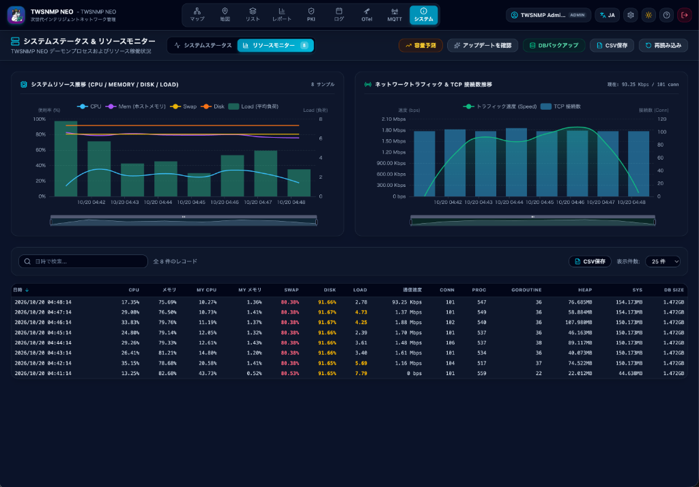

### 通知設定（Email / Webhook）

障害検知時や定期レポートの送信先として、以下の通知方式に対応しています：
- **Email** (SMTP / Google OAuth2 / Microsoft 365 OAuth2) - HTML 形式のサマリーメール（TWSNMP NEO への直接アクセスリンク付き）および毎朝の定期日報レポート
- **Webhook** - 障害発生時のリアルタイムアラートおよび日報レポートの Webhook POST 送信（運用システムやWebhookレシーバーとの連携）
- **外部コマンド実行** - 障害レベル（重大/軽微/注意/復帰）の変化に連動した任意のOSスクリプト・コマンド実行

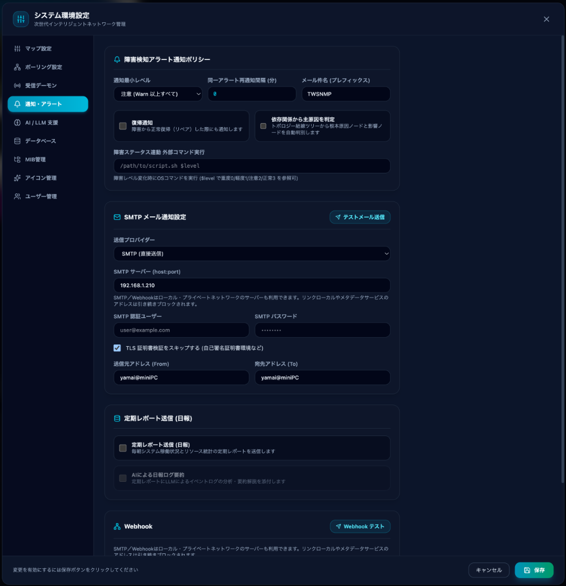

### バックアップ & データローテーション

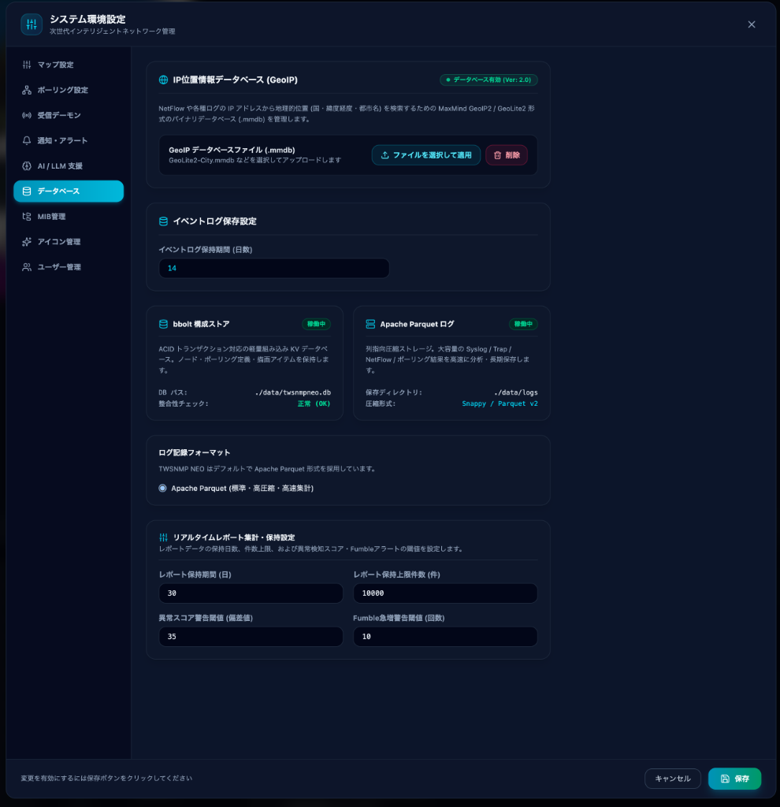

- **マップエクスポート**: マップデータ、ノード、ポーリング定義を JSON / ZIP 形式でダウンロード。
- **Parquet 自動ローテーション**: 指定した容量（GB）または保存日数を超えた過去ログを安全に自動パージ。

### アイコン管理

標準の Material Design Icons（MDI）に加えて、オリジナルの PNG/JPEG/SVG 画像アイコンの追加・インポート/エクスポートが可能です。

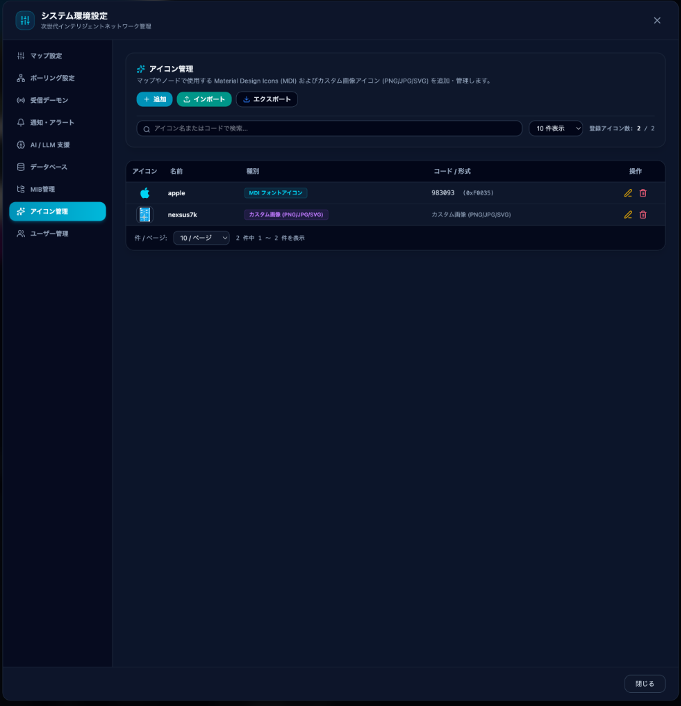

### ユーザー管理 & アクセス権限

役割ベースの権限（`ADMINISTRATOR` / `OPERATOR` / `READ-ONLY`）によるマルチユーザー管理と、安全なパスワード設定・運用に対応しています。

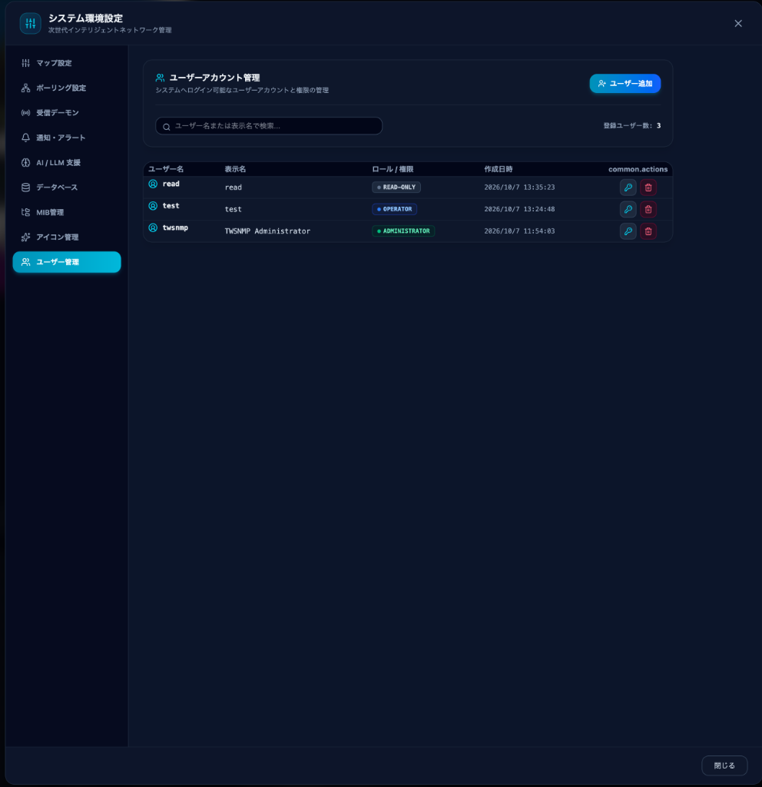

---

## まとめ

TWSNMP NEO により、軽量・高速でありながら、3D 可視化・大容量ログ分析・AI 支援を兼ね備えた最新のネットワーク運用が手軽にスタートできます。
ぜひ Docker やバイナリでお試しください。

