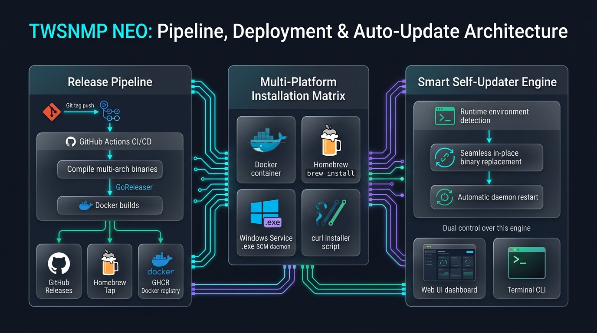
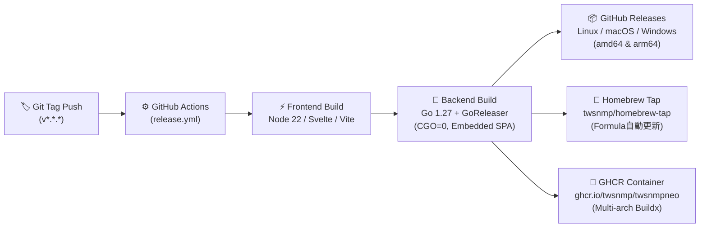

[English (English Manual)](./index.html) | [マニュアル目次](./index_ja.html)

# TWSNMP NEO ライフサイクルガイド
## リリース自動化パイプライン・環境別インストール・スマート自己更新

TWSNMP NEO は、モダンな CI/CD パイプラインによる継続的リリース、Docker / Windows / macOS (Homebrew) / Linux へのマルチプラットフォーム対応、そして動作環境を自動判別して安全に自己更新するインテリジェント・アップデータ（Self-Updater）を備えています。



> 💡 **ベクター画像版（SVG）**: 文字の拡大やコピーが可能なベクター版インフォグラフィックは [こちら（SVG形式）](./images/twsnmpneo_lifecycle_infographic.svg) から参照できます。

---

## 目次
1. [リリース自動化パイプライン (CI/CD)](#1-リリース自動化パイプライン-cicd)
   - [ワークフロー概要](#ワークフロー概要)
   - [ビルドマトリクスと配信ターゲット](#ビルドマトリクスと配信ターゲット)
2. [環境別インストール手順](#2-環境別インストール手順)
   - [Docker / Docker Compose（推奨）](#docker--docker-compose推奨)
   - [Homebrew (macOS / Linux)](#homebrew-macos--linux)
   - [Windows (スタンドアロン &amp; Windows サービス常駐)](#windows-スタンドアロン--windows-サービス常駐)
   - [Linux (curl インストーラー &amp; systemd サービス)](#linux-curl-インストーラー--systemd-サービス)
3. [スマート自動更新機能 (Self-Updater)](#3-スマート自動更新機能-self-updater)
   - [環境自己判定エンジン](#環境自己判定エンジン-updaterdetectenvironment)
   - [CLI による更新コマンド](#cli-による更新コマンド)
   - [Web UI 管理画面からのワンクリック更新](#web-ui-管理画面からのワンクリック更新)
   - [Windows サービス常駐時の安全な自動再起動](#windows-サービス常駐時の安全な自動再起動)

---

## 1. リリース自動化パイプライン (CI/CD)

TWSNMP NEO のリリースは、GitHub Actions ワークフロー（`.github/workflows/release.yml`）および **GoReleaser** によって完全自動化されています。



### ワークフロー概要

1. **リリースタグの Push**:
   ```bash
   git tag v1.0.0
   git push origin v1.0.0
   ```
   `v*` 形式のタグが GitHub にプッシュされると、自動的に `release.yml` がトリガーされます。
2. **フロントエンド静的アセットのビルド**:
   - Node.js 22 & `pnpm` を使用し、SvelteKit / Vite SPA をビルド（`pnpm run build`）。
   - 生成された静的成果物は、Go バックエンドの `backend/dist` ディレクトリに配置され、Go 1.16+ `embed` パッケージによりシングルバイナリへ内蔵されます。
3. **GoReleaser によるクロスコンパイル**:
   - `CGO_ENABLED=0` で完全静的リンクされた実行バイナリを高速生成。
   - コード最適化フラグ `-s -w -trimpath` によりバイナリサイズを最小化。

### ビルドマトリクスと配信ターゲット

| 配布チャネル | プラットフォーム | 成果物形式 | 特徴 |
| :--- | :--- | :--- | :--- |
| **GitHub Releases** | Linux, macOS, Windows<br>(amd64 / arm64) | `.tar.gz`<br>(Windowsは `.zip`) | シングル実行バイナリ。依存ライブラリ不要で即座に実行可能。 |
| **Homebrew Tap** | macOS (Apple Silicon / Intel)<br>Linux (x86_64 / aarch64) | Homebrew Formula | `twsnmp/homebrew-tap` へコミットを自動反映。`brew install / upgrade` で管理可能。 |
| **GitHub Container Registry (GHCR)** | Linux (`linux/amd64`, `linux/arm64`) | OCI コンテナイメージ | Docker Buildx & QEMU によるマルチアーキテクチャ対応。`ghcr.io/twsnmp/twsnmpneo:latest` として配信。 |

---

## 2. 環境別インストール手順

### Docker / Docker Compose（推奨）

ネットワーク監視に必要な各種レシーバーポート（Syslog 514, SNMP TRAP 162, NetFlow 2055, sFlow 6343）やストレージを安全に分離・管理できます。

#### Docker 単体での起動
```bash
docker run -d \
  --name twsnmpneo \
  --restart always \
  -p 8080:8080 \
  -p 514:514/udp \
  -p 162:162/udp \
  -p 2055:2055/udp \
  -p 6343:6343/udp \
  -v $(pwd)/data:/data \
  ghcr.io/twsnmp/twsnmpneo:latest
```

#### Docker Compose による起動
`docker-compose.yml` を作成します：
```yaml
services:
  twsnmpneo:
    image: ghcr.io/twsnmp/twsnmpneo:latest
    container_name: twsnmpneo
    restart: always
    ports:
      - "8080:8080"
      - "514:514/udp"
      - "162:162/udp"
      - "2055:2055/udp"
      - "6343:6343/udp"
    volumes:
      - ./data:/data
```
起動コマンド：
```bash
docker compose up -d
```
ブラウザで `http://localhost:8080` にアクセスします。

---

### Homebrew (macOS / Linux)

macOS や Linuxbrew 環境では、公式 Tap リポジトリからコマンド一つでインストールできます。

```bash
# 1. Tap & インストール
brew install twsnmp/tap/twsnmpneo

# 2. 起動
twsnmpneo -datastore ./data -port 8080
```

---

### Windows (スタンドアロン & Windows サービス常駐)

Windows 環境では、コンソールでの直接実行に加えて **Windows サービス（Service Control Manager: SCM）** としてバックグラウンド常駐させることが可能です。

#### 1. ダウンロード & 展開
[GitHub Releases](https://github.com/twsnmp/twsnmpneo/releases) から最新の `twsnmpneo_windows_amd64.zip` をダウンロードし、任意のフォルダ（例: `C:\twsnmpneo`）に展開します。

#### 2. Windows サービスとしての登録（管理者権限で実行）
管理者権限で PowerShell またはコマンドプロンプトを開き、以下のコマンドを実行します：

```powershell
# サービス登録（OS起動時の自動起動を有効化）
.\twsnmpneo.exe service install -service-auto -datastore C:\twsnmpneo\data -port 8080

# サービスの開始
.\twsnmpneo.exe service start

# サービス状態の確認
.\twsnmpneo.exe service status
```

> **メリット**:
> - ログオフ中や OS 再起動後もバックグラウンドで監視を継続。
> - Windows 標準の `services.msc` からも開始・停止・自動起動設定が可能。
> - 不要になった場合は `.\twsnmpneo.exe service remove` で安全に登録解除可能。

#### コンソールからの直接起動（開発・テスト用）
```powershell
.\twsnmpneo.exe -datastore .\data -port 8080
```

---

### Linux (curl インストーラー & systemd サービス)

#### 1. curl ワンライナーによるインストール
```bash
# インストールスクリプトの実行（/usr/local/bin/twsnmpneo に配置）
curl -sS https://raw.githubusercontent.com/twsnmp/twsnmpneo/main/install/install.sh | sh

# CI環境や自動化スクリプトでの非対話実行（プロンプトを自動承諾）
curl -sS https://raw.githubusercontent.com/twsnmp/twsnmpneo/main/install/install.sh | sh -s -- -y
```

#### 2. 特権ポート & Rawソケット（ICMP Ping）の許可
Linux で非 root ユーザーとして実行する場合、以下のケーパビリティ（Linux Capabilities）を付与します：
```bash
sudo setcap 'cap_net_bind_service,cap_net_raw+ep' /usr/local/bin/twsnmpneo
```

#### 3. systemd サービスへの登録
```bash
sudo twsnmpneo service install -service-auto -datastore /var/lib/twsnmpneo -port 8080
sudo twsnmpneo service start
```

---

## 3. スマート自動更新機能 (Self-Updater)

TWSNMP NEO は、内部に **環境自己判定エンジン（`updater.DetectEnvironment`）** を内蔵しており、動作環境を自動的に判別して安全な更新アプローチを実行・案内します。

### 環境自己判定エンジン (`updater.DetectEnvironment`)

| 実行環境 | 判定条件 | 動作と案内メッセージ | セルフ更新 |
| :--- | :--- | :--- | :---: |
| 🐳 **Docker / Container** | `/.dockerenv` または cgroup コンテナ識別子 | コンテナ内の直接書換は行わず、`docker compose pull && docker compose up -d` を案内 | ❌ (安全保護) |
| 🍺 **Homebrew** | `/Cellar/` または `/opt/homebrew` 配下のパス | Homebrew の管理整合性を保つため、`brew upgrade twsnmp/tap/twsnmpneo` を案内 | ❌ (安全保護) |
| 🛠️ **Debug / Dev** | 開発中ビルドまたはデバッグフラグ | ソースコード開発中のバイナリ誤上書きをブロック保護 | ❌ (安全保護) |
| ⚡ **Standalone / curl / Windows / Linux** | 直接配置バイナリ | **インプレース自己バイナリ差し替え &amp; 自動プロセス再起動**を実行可能 | ✅ **フル対応** |

---

### CLI による更新コマンド

`twsnmpneo update` サブコマンド（または `-update` フラグ）を使用して、コマンドラインから直接バージョン管理を行えます。

```bash
# 1. 更新の有無・環境ステータスのみを確認
twsnmpneo update -check

# 2. 最新リリースへ対話的に更新（ダウンロード、バイナリ検証、自動再起動）
twsnmpneo update

# 3. 確認プロンプトなしで即時更新（CI / cron / スクリプト向け）
twsnmpneo update -y

# 4. 特定バージョンへのアップデートまたはロールバック
twsnmpneo update -version v1.0.0
```

---

### Web UI 管理画面からのワンクリック更新

- **ETag キャッシュ対応**: GitHub Releases API のレート制限（RateLimit）を消費しないよう、ETag 条件付きリクエスト（`304 Not Modified`）で効率的に更新をポーリング。
- **UI バナー通知**: 新しいバージョンがリリースされると、Web ブラウザの管理画面ヘッダーに更新通知バナーが表示されます。
- **ワンクリック適用**: 「今すぐ更新」をクリックすると、バックエンドで新バイナリのダウンロード・チェックサム検証・置換・グレースフルシャットダウン・再起動が一連で実行されます。
- **REST API エンドポイント**:
  - `GET /api/system/updater/check`: 更新情報の取得
  - `POST /api/system/updater/apply`: 更新の実行
  - `GET /api/system/updater/status`: 進行状況（`downloading` -> `extracting` -> `restarting`）の確認

---

### Windows サービス常駐時の安全な自動再起動

Windows 環境において、動作中の実行ファイル（`.exe`）は OS によってファイルロックされます。また、サービスとして常駐している場合、自身から単純に新プロセスを起動しても SCM（サービスコントロールマネージャー）の管轄外となってしまいます。

TWSNMP NEO ではこの問題を解決するため、以下のフローで安全に更新を行います：

1. 新バージョンのバイナリを一時ファイルとしてダウンロードし、整合性を検証。
2. 実行中の `twsnmpneo.exe` を一時退避し、新バイナリをアトミックに配置。
3. Windows サービスとして動作している場合、**SCM 連携用デタッチプロセス**をスケジュール：
   ```cmd
   cmd.exe /C "timeout /t 3 /nobreak >nul & sc start twsnmpneo"
   ```
4. カレントプロセスが安全に停止（グレースフルシャットダウン）した後、SCM 経由で新バージョンのサービスが自動起動します。
